<div align="center">


# Strata for Windows

**A keyboard-friendly file manager with tabs, rich previews and Windows Shell integration.**

[](#installation)
[](https://github.com/IKurokami/strata/releases/latest)
[](LICENSE)

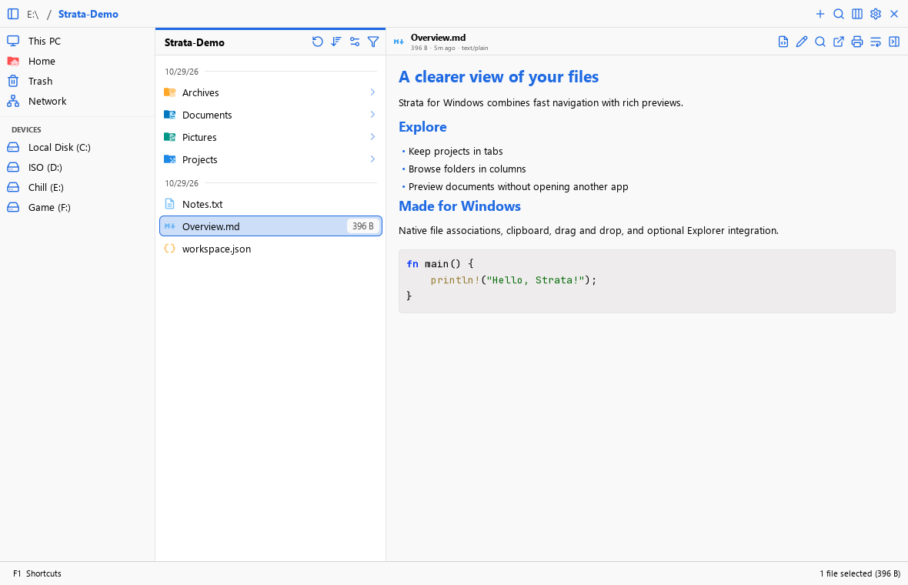

</div>

This is a **Windows-focused fork** of [LGSE/Strata](https://github.com/lgse/strata).
It keeps Strata’s GTK4 interface and keyboard navigation, adds Windows integration,
and ships a bundled native runtime. Releases and the Windows updater use
**IKurokami/strata**. The upstream project remains the reference for Linux and
Omarchy development.

## Installation

Download the Windows x64 installer from [the latest stable release](https://github.com/IKurokami/strata/releases/latest).
Run `Strata-1.0.1-windows-x64-setup.exe`. Installation is per-user and does not
require MSYS2, Rust or administrator access.

For portable use, download `strata-1.0.1-x86_64-pc-windows-gnu.zip`, extract the
**entire archive**, and run `Start-Strata.exe`. Keep its `bin`, `lib` and `share`
folders together. Copying only `strata.exe` is not a portable installation.

### Updates

Use **Settings → Updates** to check for new versions and install updates.
Stable releases are the default channel; enable prerelease updates to try RCs.
Windows update archives have an Ed25519-signed manifest and a verified SHA-256
checksum. Each release also includes `SHA256SUMS` and a standalone installer.

## Replace File Explorer

Strata can become your default file manager for opening **folders and drives**,
including **Win+E**.

1. Open **Settings → General → Desktop integration**.
2. Enable **Replace File Explorer**.
3. Press **Win+E**, open a folder from another application, or use Chrome's
   **Show in folder**. Strata brings its existing window forward and opens or
   reuses a tab; supported Shell reveal requests also select the requested file.

The integration is per-user and does not require administrator access. Turning
the option off stops the integration and restores the previous registrations;
uninstalling also restores them. Other file managers' later changes are preserved.
Windows Open/Save file dialogs retain their normal system behavior.

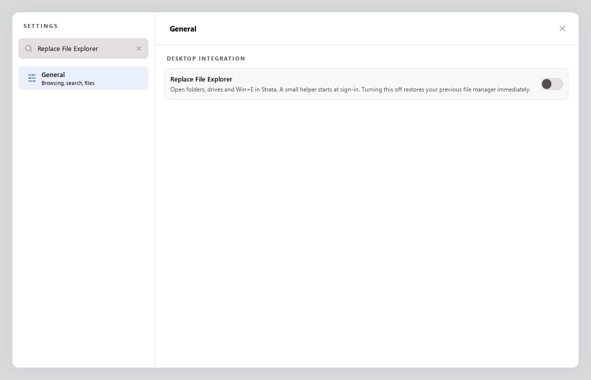

## Features

- **One window, many tabs.** Columns, Icons, List and Disk Usage views share navigation, selection and file actions.
- **Windows integration.** Open files with their associated applications, use Open with and native Properties, and exchange local files with Explorer and other apps through clipboard and drag-and-drop.
- **Rich previews.** Images, animated GIF/WebP, PDF, text, source code, Markdown, audio and video. Video includes timeline previews and scrubbing; large text previews are bounded.
- **Discord text editing.** Fenced ANSI text renders in color immediately. Edit ANSI and Markdown inside the preview panel, with selection tools, visual colors, gradients, undo/redo and explicit copy/save. See [supported formats and limits](docs/discord-editor.md).
- **Storage views.** This PC shows drives and capacity. Disk Usage scans in the background and presents a stable map while scanning. See [Disk Usage](docs/disk-usage.md).
- **Local search.** Fast filename search plus local semantic image/text search after the optional model download. Models run locally; see [Smart Search](docs/smart-search.md).
- **Archive extraction.** Grouped extraction actions, extraction into a same-named folder, password prompts and the Windows archive backend. Supported formats include ZIP, 7z, TAR and RAR.
- **Appearance and preferences.** Light/dark themes, macOS Classic themes, colored Material file icons, Windows font selection, and remembered folder sorting/view choices.
- **Background access.** A tray icon, optional background residency, and manual cache clearing from Settings or the tray.

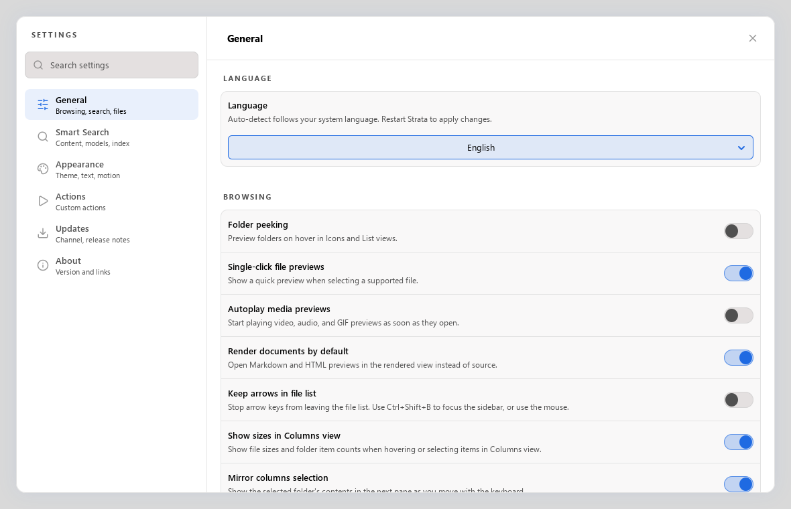

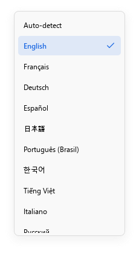

## Feature gallery

Screenshots show the actual Windows application with demo files. Theme, font and
icon choices can be changed in Settings.

### Browse pictures and projects

Switch between **Columns**, **Icons**, **List** and **Disk Usage** using the
top-right view menu or **Ctrl+1–4**. Use tabs to keep several folders open in one
window.

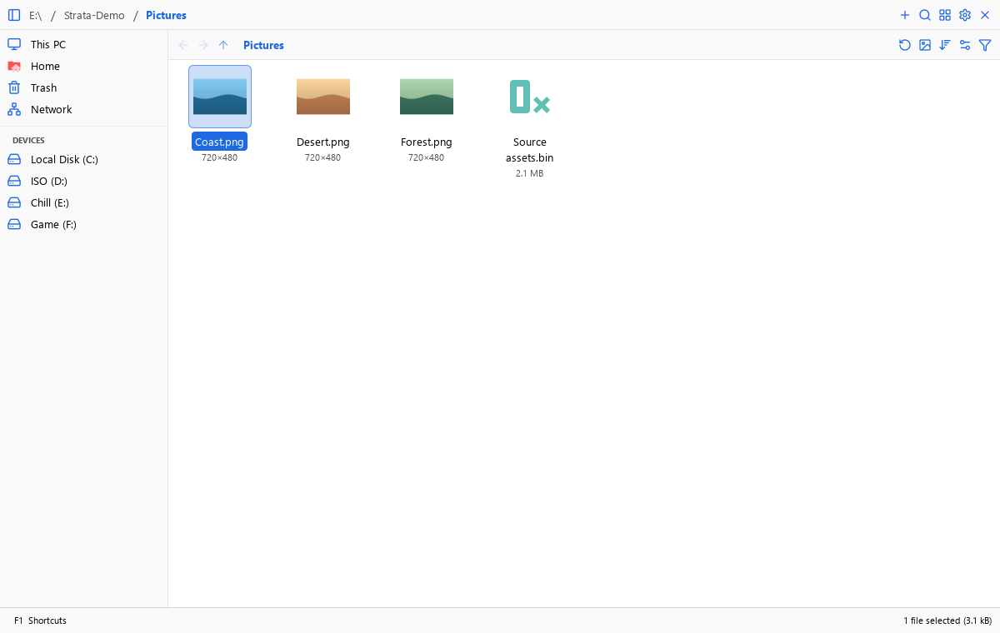

### This PC and Disk Usage

Choose **This PC** in the sidebar to see drives, free space and capacity bars.
Drive capacity comes from Windows volume information; it does not require a
recursive folder scan. **Disk Usage** scans the selected folder in the background
and lets you explore which items take up space.

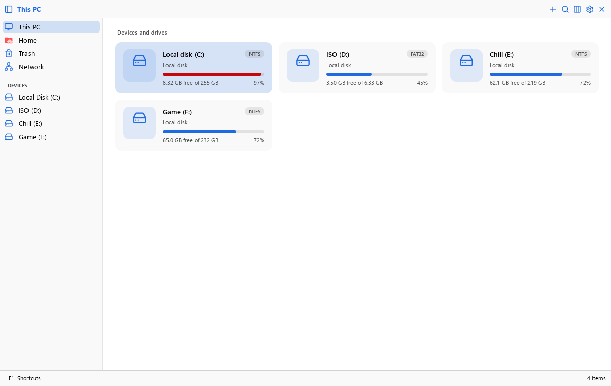

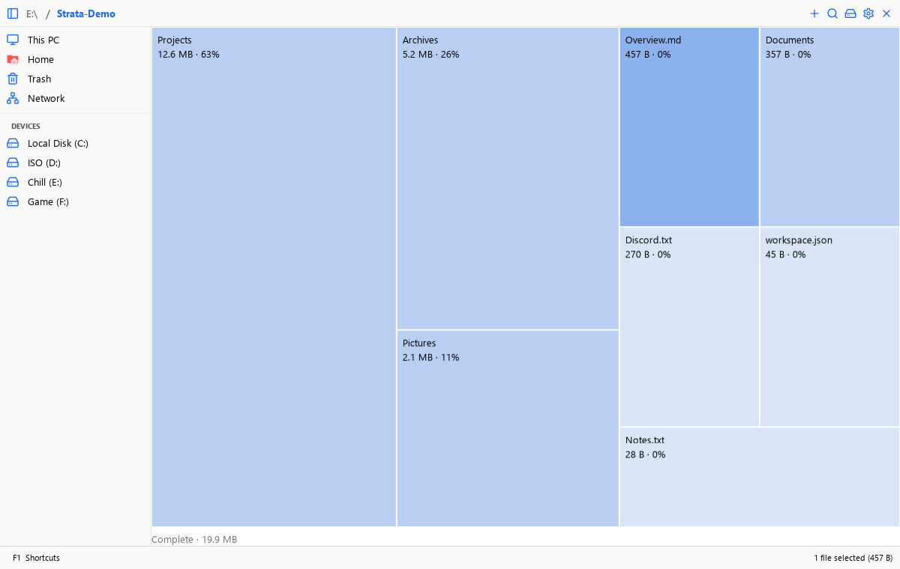

### Smart Search

Press **Ctrl+K** to search. Add folders under **Settings → Smart Search → Indexed
folders** to search inside supported documents as well as filenames. Select a
result to preview it without leaving search.

The example below uses real indexed demo documents and a content query.
Keyword search works without downloading AI models. For semantic text/image
search, explicitly choose **Download models** in Smart Search settings. Indexing
and inference run locally; file contents and queries are not uploaded.

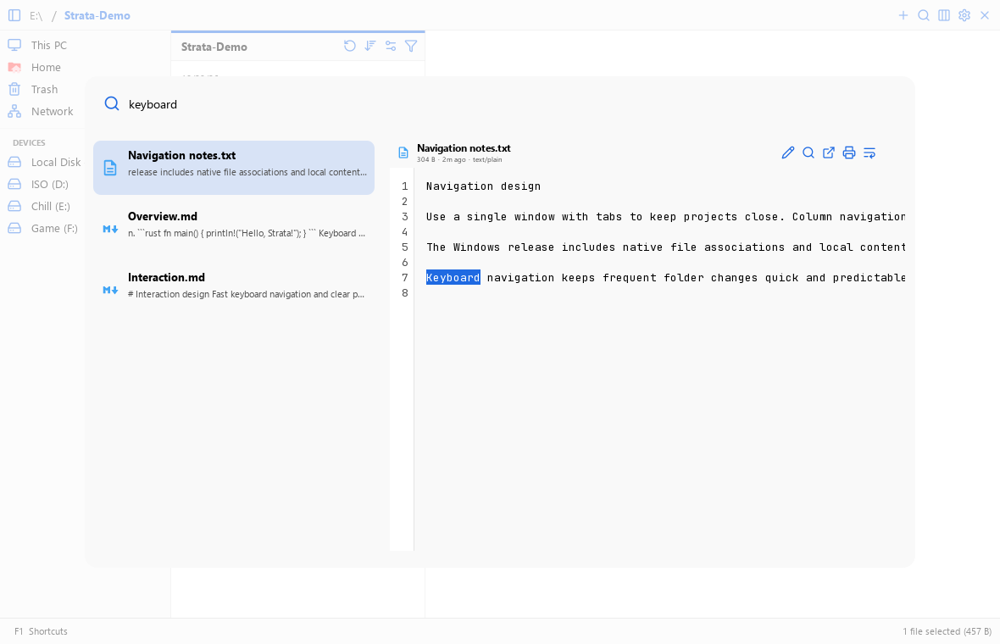

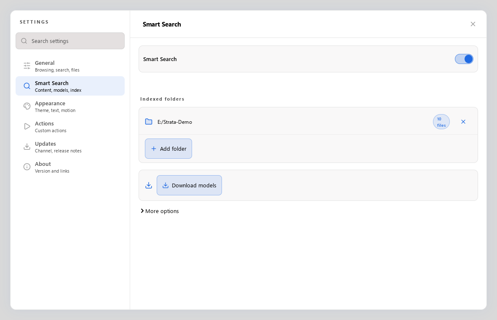

See [Smart Search setup, privacy and limits](docs/smart-search.md) for supported
formats, exclusions and indexing budgets.

### Discord ANSI and text previews

Text containing a fenced `ansi` block renders in color directly in preview. Enter
edit mode to format a selection, pick colors, apply a gradient, and copy or save
Discord-compatible text. Plain text remains available as an ordinary preview.

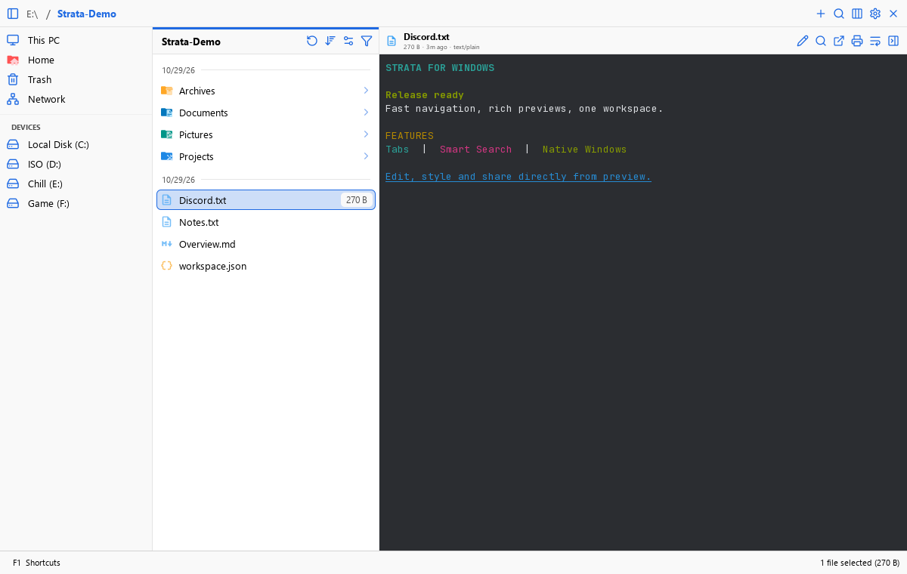

### Make the interface yours

Choose a theme, colored file icons, any available Windows font, and motion
preferences in **Settings → Appearance**.

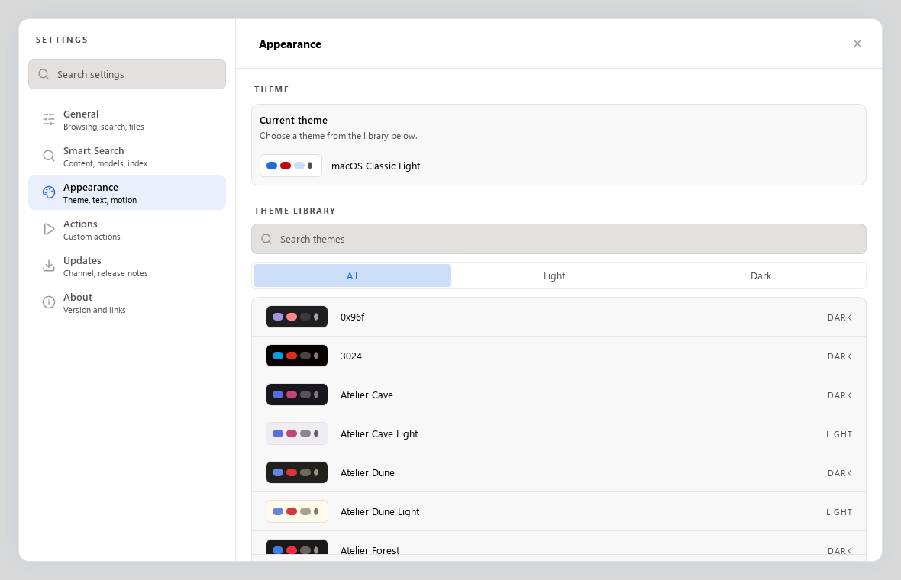

## Everyday Windows file actions

Copy, cut and paste local files between Strata, Explorer and compatible Windows
applications. Drag files into other apps, open them with their associated
programs, or choose **Open with** from the context menu. Archive actions are
grouped together and include extraction into a folder with the archive's name.

**Delete using Windows** requests the Recycle Bin, like ordinary Explorer Delete.
Permanent deletion is a separate action. Windows Properties can be selected in
Settings and remains available from the Open in menu.

Enable **Settings → General → Startup → Keep Strata running in the background**
to keep the initialized application available from the tray. Closing its window
then hides it; opening Strata again brings it back. Use **Quit Strata** to exit
fully. Cache clearing is available in Settings and the tray menu.

Native integrations cover local Windows paths. Remote locations and individual
Shell extensions can have different capabilities.

## Getting around

| Action | Shortcut |
| --- | --- |
| New tab | Ctrl+T |
| Close tab | Ctrl+W |
| Address/location bar | Ctrl+L |
| Search | Ctrl+K |
| Preview selected file | Space |
| Copy / Cut / Paste | Ctrl+C / Ctrl+X / Ctrl+V |
| Rename | F2 |
| New folder | Ctrl+Shift+N |
| Refresh | F5 |
| Undo | Ctrl+Z |
| Settings | Ctrl+, |
| Shortcut reference | F1 |

Use the in-app shortcut reference for the active keyboard map. See
[keyboard navigation](docs/keyboard-navigation.md) and
[preview panel behavior](docs/preview-panel-layout.md) for more detail.

## Development on Windows

Use the native **MSYS2 UCRT64** toolchain and the project’s private GTK/GStreamer
runtime. Start with [Windows development](docs/windows-development.md) for the
required packages, environment and runtime build instructions.

From PowerShell in the checkout:

```powershell
.\scripts\windows\dev.ps1 -Action build
.\scripts\windows\dev.ps1 -Action run
```

The development helper builds the application and Shell helper and stages the
private runtime. Optimized builds and packaging are documented in
[Windows development](docs/windows-development.md) and
[the Windows runtime notes](packaging/windows/runtime/README.md).
The packaged application includes the required GTK/GStreamer libraries, plugins
and FFmpeg tools.

Additional references:

- [Contributing](CONTRIBUTING.md)
- [Architecture](docs/architecture.md)
- [Saved preferences](docs/preferences.md)
- [Custom actions](docs/custom-actions.md)
- [Themes](docs/themes.md)
- [Release process](docs/releasing.md)

## Upstream and credits

The original Strata project is developed by [LGSE and its contributors](https://github.com/lgse/strata/graphs/contributors).
This fork focuses on Windows compatibility, integration and distribution, and
selectively brings in useful upstream fixes. For Linux installation and desktop
integration, use [the upstream documentation](https://github.com/lgse/strata#installation).

## License

Strata source is distributed under the [MIT License](LICENSE). Bundled runtime
libraries, fonts, icons and optional archive components retain their own licenses
and notices; see [THIRD_PARTY_LICENSES.md](THIRD_PARTY_LICENSES.md).
